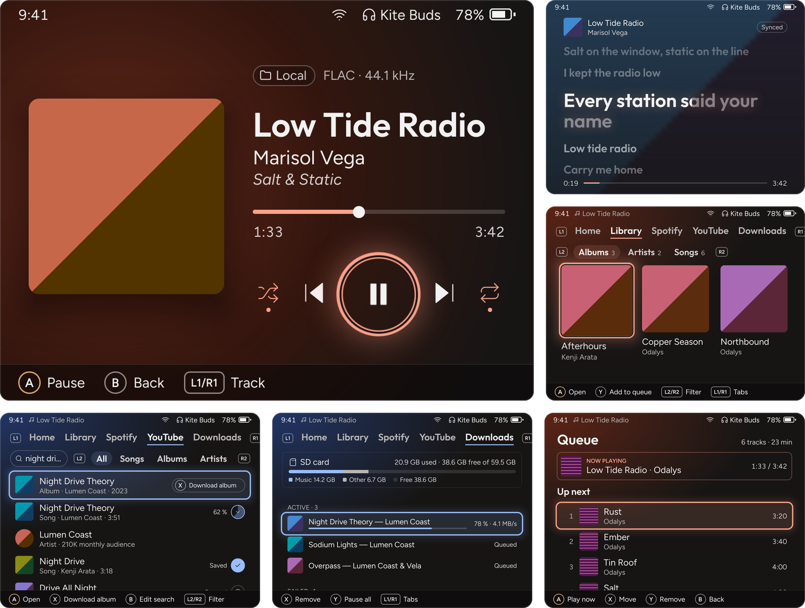

# Boombrick

A music player for the [TrimUI Brick](https://trimui.com) running [NextUI](https://github.com/LoveRetro/NextUI) or [CrossMix](https://github.com/cizia64/CrossMix-OS). It plays the music on your SD card, streams your Spotify playlists, finds covers and synced lyrics, and downloads songs and albums from YouTube Music for offline listening. Its colours come from the album that's playing.

<p align="center">
  
</p>

See [CHANGELOG.md](CHANGELOG.md) for what each release adds.

## Features

- **Your music:** MP3, FLAC, Opus and M4A (AAC), gapless, with ReplayGain levelling. Browse by album, artist or song; the queue has shuffle and repeat and is kept between launches.
- **Covers** from the files, folder pictures or the Cover Art Archive.
- **Synced lyrics** from the files, `.lrc` files or LRCLIB, with the line being sung highlighted.
- **YouTube Music:** search, browse albums and artists, and download songs as tagged Opus files with covers and lyrics. A song that is still downloading plays as soon as it lands.
- **Spotify** (Premium): sign in with a code on your phone, then play Liked Songs and your playlists, Spotify's own mixes included, in the same queue as your music. Streams play at 96, 160 or 320 kbps over Wi-Fi.
- **Spotify import:** download your playlists' songs, or Liked Songs, from YouTube Music to keep them offline. Each song is matched by its ISRC, or its title, artist and length, and you check the doubtful ones. A Spotify song with a downloaded copy plays the copy, without Wi-Fi.
- **Sleep timer:** 15 to 60 minutes, or the end of the track or album, with a fade.
- **Play in background** from the quick menu: the music goes on after you leave Boombrick, as while you play a game, with the volume keys as usual. Open Boombrick again to take it back.
- **Screen off** with Power, with the music still playing and the buttons for skipping and pausing still working.
- **Updates** for Boombrick and its downloader, from Settings.

## Installing

You need a TrimUI Brick with NextUI or CrossMix. Wi-Fi is used for Spotify, YouTube Music, covers, lyrics and updates; music on the card plays without it. Spotify needs a Premium account.

1. Download the zip for your firmware:
   - **NextUI:** `Boombrick.pak.zip` from the [latest release](https://github.com/ujjwal313/boombrick/releases/latest).
   - **CrossMix:** `Boombrick-CrossMix.zip` from the same release.

   `Boombrick-PakStore.zip` holds the same NextUI app for the Pak Store, which unzips it into the app's folder; it isn't for the root of the card.
2. Unzip it at the root of the SD card. It goes to `Tools/tg5040/Boombrick.pak` on NextUI and `Apps/Boombrick` on CrossMix.
3. Put your music in the card's `Music` folder, in any layout; `Artist/Album/01 Title.flac` works best when files have no tags.
4. Start Boombrick from Tools on NextUI, or from Apps on CrossMix. The library is scanned on the first launch, and again on every launch after that.

Betas are pre-releases: Settings never offers them, so they are only installed by hand. A beta is offered the next full release like any other version.

### Updating

Open Settings from the quick menu (Menu). When a newer release is out, the Boombrick card offers **Update Boombrick**. The update downloads, is checked, and is installed the next time Boombrick starts; choose **Quit now** and open it again.

The Downloader card updates yt-dlp, which YouTube Music downloads use, the same way.

## Controls

| Button | Action |
|---|---|
| D-pad | Move |
| A | Play or open |
| B | Back |
| X | Download (YouTube Music) |
| Y | Add to the queue; on Now Playing, lyrics |
| L1, R1 | Switch tabs; on Now Playing, previous and next track |
| L2, R2 | Filters in the Library and YouTube Music |
| Start | Now Playing |
| Select | Queue |
| Menu | Quick menu: sleep timer, screen off, play in background, Settings, quit |
| Power | Screen off and on; hold for a second to power off |

With the screen off, L1 and R1 skip back and on, and A plays or pauses. Each screen shows its buttons along the bottom.

## Files

On the SD card:

| What | NextUI | CrossMix |
|---|---|---|
| Your music | `Music/` | `Music/` |
| Downloads | `Music/Boombrick/<Artist>/<Album>/` | `Music/Boombrick/<Artist>/<Album>/` |
| Library, covers, lyrics, downloader, Spotify sign-in | `.userdata/tg5040/Boombrick/` | `Apps/Boombrick/data/` |
| Log | `.userdata/tg5040/logs/Boombrick.txt` | `Apps/Boombrick/logs/Boombrick.txt` |

Settings → Storage shows how much room the caches take and clears them. Your music and downloads are never touched.

An empty file named `perf` in Boombrick's folder (`Tools/tg5040/Boombrick.pak/` or `Apps/Boombrick/`) turns on perf mode, which logs launch times and, every 10 seconds, memory, CPU and frame times.

## Building

Development happens on Linux. On Windows, use WSL with Ubuntu 24.04.

```
bash scripts/setup-wsl.sh   # once: Go, SDL2 headers, build tools
make test
make run                    # desktop window at 1024x768
```

The device build needs Docker:

```
make pak VERSION=0.1.1      # dist/Boombrick.pak.zip, for NextUI
make crossmix VERSION=0.1.1 # dist/Boombrick-CrossMix.zip, for CrossMix
```

On the desktop the keyboard stands in for the Brick's buttons:

| Brick | Keyboard |
|---|---|
| D-pad | Arrow keys |
| A, B, X, Y | K, J, I, U |
| L1, R1 | Q, E |
| L2, R2 | 1, 3 |
| Start, Select | Return, Tab |
| Menu | Escape |
| Power | P (holding it quits) |
| Volume down, up | -, = |

`BOOMBRICK_PERF=1 make run` turns on perf mode.

### Releasing

Add a section for the version to [CHANGELOG.md](CHANGELOG.md), then push a tag such as `v0.1.2`. The Release workflow builds both zips with that version and publishes them, with their `SHA256SUMS` and the changelog section as notes. Bricks running an older version are offered it in Settings.

A tag with a suffix, such as `v0.2.0-beta.1`, is published as a pre-release, which Settings never offers: it is for testers, who install it by hand.

## Licence

GPL-3.0. See [LICENSE](LICENSE) and [NOTICE](NOTICE).
